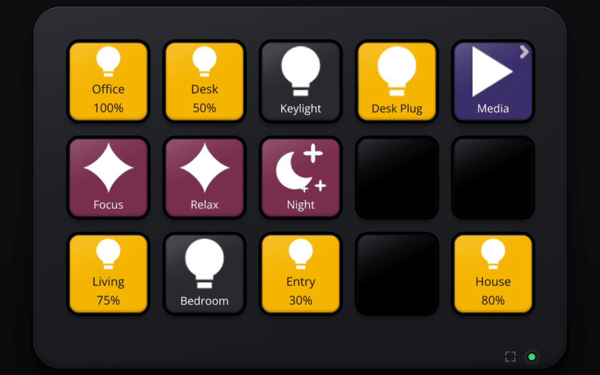

# stream-deck-controller

Control Home Assistant from a Stream Deck, with the key layout and behaviour written in Lua.



- **What**: a server that runs your Lua config, follows Home Assistant and renders every key; thin clients (a
  Raspberry Pi with a real Stream Deck, any browser, Elgato's Stream Deck app via a plugin) just show the images and
  report presses.
- **Why**: one `config.lua` drives every deck, hot-reloads on save, and tracks Home Assistant state automatically:
  a key re-renders only when an entity it read changes.
- **Extras**: pages, album art spanning several keys, idle dim/off/home, icons from files, URLs, S3 or Home Assistant
  artwork, USB suspend on the Pi, self-updating clients.

## Quickstart

```sh
nix develop                      # pinned toolchain (or install Rust + task yourself)
export HA_URL=https://homeassistant.local:8123 HA_TOKEN=...    # required by the server
task run-server                  # runs ./config.lua on :7700
SDC_DECK_AUTH=none task run-server    # same, and lets you open http://127.0.0.1:7700/deck in a browser
```

Then edit [config.lua](config.lua) and watch the deck update. For a real deck run `task run-client`, set up a Pi with
`task pi:install`, or deploy the server with Docker or Kubernetes.

## Documentation

- [Overview](docs/overview.md): architecture and feature tour
- [Configuration guide](docs/configuration.md): writing `config.lua`
- [Raspberry Pi deck](docs/pi.md), [Browser deck](docs/browser.md), [Elgato plugin](docs/plugin.md)
- [Deployment](docs/deploy.md): Docker, Kubernetes, CI
- Reference: [crates/server/README.md](crates/server/README.md) (full Lua API and environment variables)

## Components

- `crates/server` (`sdc-server`): talks to Home Assistant, runs the Lua config (`config.lua`), renders key
  images. Env: `SDC_CONFIG`, `HA_URL`, `HA_TOKEN`, `SDC_LISTEN` (default `0.0.0.0:7700`),
  `SDC_CLIENT_DIR` (client binaries to distribute), `SDC_CLIENT_TOKEN` (shared client secret), `SDC_ASSETS_S3_*`
  (icon bucket, see `crates/server/README.md`), `RUST_LOG`. It also defines and distributes the client
  binary: see [Client distribution](#client-distribution-and-auth).
- `crates/client` (`sdc-client`): thin, static binary next to the deck. Sends key down/up, shows JPEG frames
  from the server, reconnects automatically (also handles deck unplug/replug).
- `crates/protocol` (`sdc-protocol`): the wire contract (JSON text frames + binary image frames).
- `plugins/elgato`: an Elgato Stream Deck plugin, a client on `/plugin/ws`, for using server-defined buttons and
  dials (`sdc.export`, `sdc.dial`) next to normal Elgato actions, including on a Stream Deck + attached to a
  laptop running Elgato's app. See [plugins/elgato/README.md](plugins/elgato/README.md).

## Client distribution and auth

The server image bundles the static client binaries (`/usr/local/share/sdc/clients/sdc-client-<target>`,
targets `aarch64-linux` and `x86_64-linux`) and serves them over HTTP on the same port as `/ws`:
`/client/<target>`, `/client/<target>.sha256`, `/healthz`. Clients self-update: `Hello` carries the client's
target and executable sha256, and if the server has a different binary it sends `Update`; the client downloads
it, verifies the hash, replaces itself and exits so systemd restarts it. `--no-update` / `SDC_NO_UPDATE` turns
this off. So the deployed server image decides which client version runs everywhere. The first install on a Pi is
pushed from your Mac with `task pi:install` ([deploy/pi/README.md](deploy/pi/README.md)).

If the server has `SDC_CLIENT_TOKEN` set, `/ws`, `/plugin/ws` and `/client/*` require `Authorization: Bearer <token>` (401
otherwise; `/healthz` stays open). Clients take the same value via `--token` / `SDC_CLIENT_TOKEN`. Without it
the server logs a warning and accepts everyone (fine for local development, not behind a public ingress).

## Local development

```sh
nix develop            # or direnv allow
export HA_URL=http://homeassistant.local:8123 HA_TOKEN=...
task run-server        # cargo run -p sdc-server -- config.lua
task run-client        # real deck;  SDC_SERVER defaults to ws://127.0.0.1:7700/ws
task list-devices      # which decks are detected
task lint test         # fmt + clippy -D warnings, tests
task plugin:build      # Elgato plugin (needs node, in the devShell); plugin:pack, plugin:link
```

Client flags/env: `--server/SDC_SERVER`, `--client-id/SDC_CLIENT_ID` (default hostname),
`--token/SDC_CLIENT_TOKEN`, `--device/SDC_DEVICE` (name of the server's `sdc.device` to use; default: the server's `sdc.default_device` for this deck type), `--brightness/SDC_BRIGHTNESS` (60), `--usb-suspend/SDC_USB_SUSPEND` (on for Linux: while the server has the screen off, close the deck so it can USB-suspend; a key press wakes it, see deploy/pi/README.md), `--no-update/SDC_NO_UPDATE`, `--list`, `--test-pattern <secs>`.

Note: `vendor/elgato-streamdeck` is a copy of the upstream crate with its hidapi backend switched to the
pure-Rust Linux backend so the client builds as a static musl binary (see `vendor/elgato-streamdeck/PATCHED.md`).

## Builds and releases

`task build-pi` / `task build-linux` produce static musl binaries via cargo-zigbuild. CI (`.github/workflows/ci.yml`)
checks, builds, pushes the multi-arch server image (including both client binaries) to `ghcr.io/bcaldwell/stream-deck-controller`, and on `v*` tags
publishes a GitHub Release with `sdc-{server,client}-{aarch64,x86_64}-linux` and the Elgato plugin
(`ca.bcaldwell.sdc.streamDeckPlugin`, also a build artifact of every run).

To release: bump `version` in the root `Cargo.toml`, merge, then `git tag vX.Y.Z && git push origin vX.Y.Z`. CI stamps
the tag's version into the plugin manifest, so the Stream Deck app sees each release as a new version.

## Deploying

- Client on a Raspberry Pi Zero 2 W: [deploy/pi/README.md](deploy/pi/README.md)
- Server on Kubernetes: `deploy/k8s/` (create the secret and config map, then `kubectl apply -k deploy/k8s`).
  `task docker` builds the image locally.
