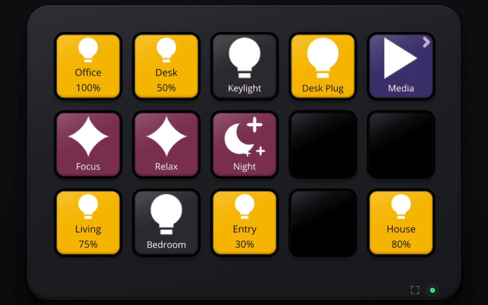
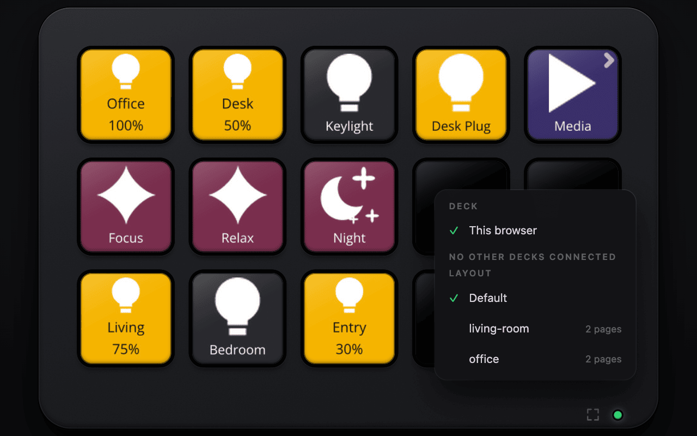
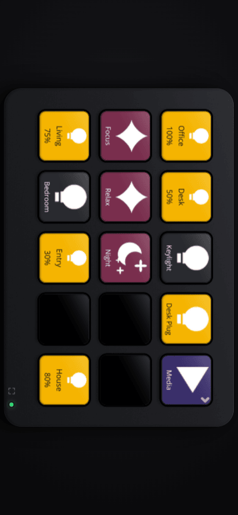

# Browser deck

`https://your-server/deck` is a Stream Deck in a web page: a dark MK.2-style body with a 3x5 grid of glossy keys that
depress when pressed. It needs no install, runs from one self-contained page (no build step, no CDN), and speaks the
same protocol as the Pi client over `/deck/ws`.



## Own deck and layouts

The browser is a client of its own with the id `web-<random>` (kept in `localStorage`), and has its own page, idle
state and brightness. Keys are rendered at 144 or 192 px depending on the screen's pixel ratio.

When the config defines [devices](configuration.md#devices), the dot on the bezel opens a menu listing "Default" and
each device name. Picking one makes this browser's deck use that device's pages, home page, brightness and idle
settings; the choice is remembered in `localStorage` and the deck reconnects.



The menu is fed by `GET /deck/api/devices` (`[{name, pages, home}]`, empty without devices).

## Phones

A portrait viewport rotates the deck by 90 degrees so it fills the screen. The bezel has a fullscreen button (which
locks landscape where the browser supports it), and the page ships a web manifest (landscape, fullscreen), so it can
be added to the home screen as an app. The LED on the bezel shows the connection: green when connected, pulsing amber
while reconnecting.



## Authentication

Every `/deck` route expects the `X-Auth-Request-Email` header that a single-sign-on proxy sets on authenticated
requests (for example Traefik forwardAuth to oauth2-proxy), and answers 401 without it. The email is logged when a
deck connects.

- The proxy must be the **only** way to reach `/deck`, because the header is trusted as is. Do not expose the server
  port directly if you rely on this.
- The bearer token (`SDC_CLIENT_TOKEN`) of `/ws` and `/client/*` is unrelated: it does not open `/deck`, and the SSO
  header does not open `/ws`.
- `/deck/ws` refuses cross-origin upgrades and forces browser ids to start with `web-`, so a browser cannot take over
  the identity of a physical deck.
- `SDC_DECK_AUTH=none` skips the check. Use it only for local development; the server logs a warning.

## Trying it locally

```sh
docker run --rm -p 127.0.0.1:7705:7700 -e SDC_DECK_AUTH=none \
  -v "$PWD:/config:ro" -e SDC_CONFIG=/config/config.lua \
  stream-deck-controller:dev          # task docker builds the image
open http://127.0.0.1:7705/deck
```

Without `HA_URL`/`HA_TOKEN` the server still runs, but `ha.state` returns `nil`, so lights show as off.
