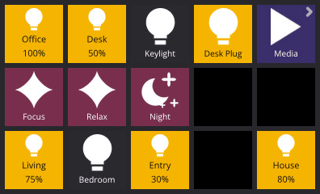
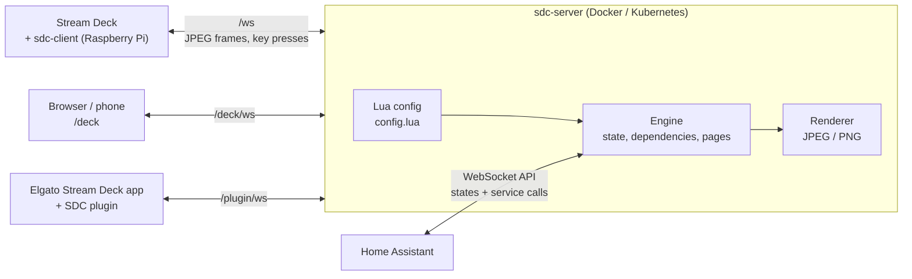
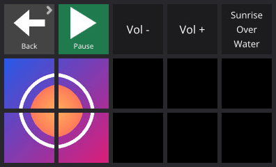
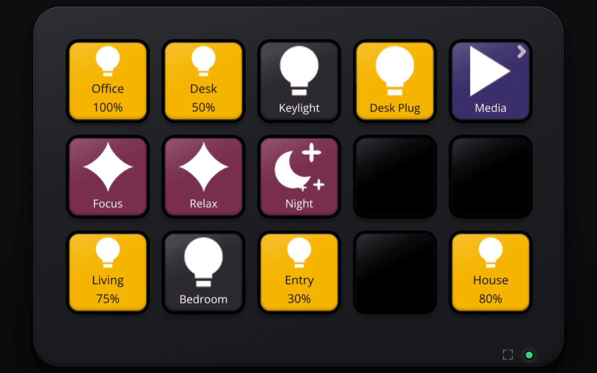

# Overview

stream-deck-controller turns an Elgato Stream Deck into a Home Assistant remote whose layout and behaviour are
a Lua script. A central **server** runs the script, follows Home Assistant, and renders every key image. The
things you press are thin **clients** that only show the JPEG frames they are sent and report key presses.



## Why this shape

- **The deck is dumb, the server is smart.** Layout, colours, icons, state tracking and page logic all live in
  one `config.lua` on the server. Saving it hot-reloads every connected deck.
- **Any number of clients.** A Raspberry Pi Zero next to a real deck, a browser tab, a phone, or Elgato's own
  Stream Deck app via a plugin, all driven by the same server and config. Each client has its own current page.
- **One static binary per role.** The server is a single static binary in a small Docker image; the client is a
  single static binary that the server distributes and keeps up to date.

## Architecture



| Part | Where it runs | Job |
|------|---------------|-----|
| `sdc-server` | Docker / Kubernetes | Connects to Home Assistant, runs the Lua config, renders key images, serves the websockets, the browser deck and the client binaries |
| `sdc-client` | Pi (or any Linux/macOS box) next to a Stream Deck | Shows frames, sends presses, reconnects, self-updates, dims and suspends USB when told to |
| Browser deck | Any browser | A Stream Deck drawn in HTML, speaking the same protocol as `sdc-client` |
| Elgato plugin | Elgato's Stream Deck app (macOS / Windows) | Shows server-defined buttons and dials next to ordinary Elgato actions |

When a Home Assistant entity changes, only the keys whose `render` function read that entity are re-rendered,
and a frame is only sent if the encoded image actually changed. A key press goes the other way: client to server,
into your Lua `press` function, usually a `ha.call(...)` service call.

## Feature tour

**Stateful buttons.** A `render` function returns text, colours, an icon or a picture. Whatever Home Assistant
entities it reads are tracked automatically, so a light button shows on/off and brightness without any polling or
subscriptions in your code. See [Configuration](configuration.md#buttons-and-render-fields).

**Pages.** Buttons can switch pages with `ctx.goto_page`. The server remembers each deck's page across
reconnects and can send an idle deck back home.



**Spans.** A `sdc.span` covers a rectangle of keys and draws one picture across all of them, such as album art
over 2x2 keys.
See [Spans](configuration.md#spans).

**Browser deck.** `/deck` is a Stream Deck in a web page, a deck of its own with the same pages and
buttons. See [Browser deck](browser.md).



**Idle handling.** Dim after a while, switch the backlight off later, go back to the home page after longer. On a
Pi the client also lets the deck's USB link suspend to save power. See [Raspberry Pi deck](pi.md#power-saving).

**Elgato app integration.** Export buttons and dials (including the touch strip of a Stream Deck +) from Lua and
place them in Elgato's app. See [Elgato plugin](plugin.md).

**Images from anywhere.** Icons and full-bleed pictures can be local files, URLs, S3 objects, or Home Assistant
media artwork. See [Icons and images](configuration.md#icons-and-images).

## Regenerating the screenshots

The pictures in `images/` are produced from [demo/config.lua](demo/config.lua) with invented entity states
([demo/states.json](demo/states.json)); no real Home Assistant is involved.

```sh
nix develop -c task docker          # builds stream-deck-controller:dev
for page in home media; do
  mkdir -p /tmp/shots/$page
  docker run --rm -v "$PWD:/config:ro" -v /tmp/shots:/out stream-deck-controller:dev \
    render --config /config/docs/demo/config.lua --out /out/$page --page $page \
    --states /config/docs/demo/states.json
done                                # /tmp/shots/<page>/page.png
```

The browser screenshots are taken from a container started with `SDC_DECK_AUTH=none` and the demo config mounted
(see [Browser deck](browser.md#trying-it-locally)).
